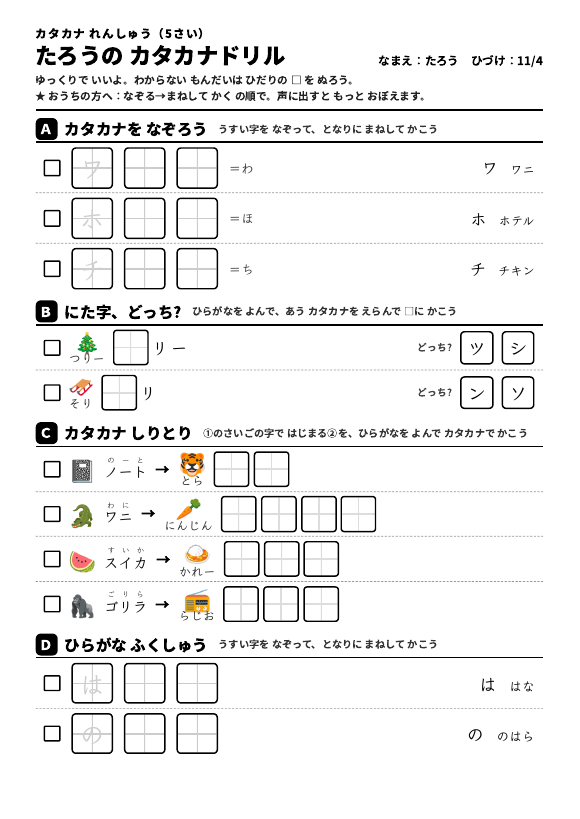
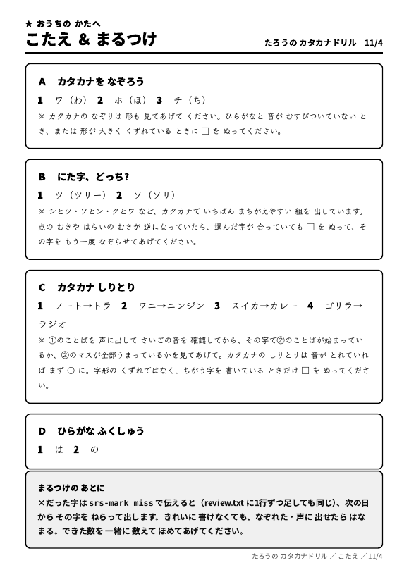

# kana-drill — 毎日1ページのかなドリルを作って、まちがえた字だけ復習する

幼児向けのカタカナ・ひらがなドリルを、1日1枚の PDF で生成する Python スクリプトです。
採点でまちがえた字を伝えると、間隔反復（SRS）で翌日・3日後・1週間後・2週間後と出し直し、4回正解した字は卒業します。

| 問題（渡す用） | 答え（まるつけ用） |
|---|---|
|  |  |

## できること

- **A4 1枚・11問**。カタカナのなぞり、にた字（シとツ・ソとン）の選択、カタカナしりとり、ひらがなの復習
- **日替わりで重複しない**。SQLite で「最近出した順」を持ち、しばらく同じ問題が出ない
- **まちがえた字だけ復習**。`srs-mark miss の は` と伝えるだけ。4回正解で卒業し、自動で紙面から消える
- **配分は環境変数で変えられる**。カタカナを減らしてひらがな主体にする、といった調整がコードを触らずにできる
- **答えの紙にまるつけのコツ**。小書き文字の位置、しりとりの採点基準など、親が見るポイントを問題に合わせて出す

## 使い方

```bash
pip install playwright && playwright install chromium   # PDF 生成に必要
# 日本語フォント（Noto Sans CJK JP など）が入っていること

export KANA_DRILL_NAME="たろう"   # 紙面に入る名前（省略可）
export KANA_DRILL_AGE=5           # 紙面の肩書き（省略可）

python3 kana_drill.py                      # 今日のぶん → data/out/kana_drill_YYYY-MM-DD.pdf と _answer.pdf
python3 kana_drill.py --date 2026-06-22    # 日付を指定
python3 kana_drill.py --html-only          # PDF を作らず HTML だけ（playwright 不要。ブラウザで印刷できる）
python3 kana_drill.py --out ~/Desktop/drill # 出力先を変える（状態は KANA_DRILL_DIR のまま）
```

日付は `python3 kana_drill.py 2026-06-22` のように位置引数でも渡せます。
PDF 生成時は字形を教科書体に寄せるため Google Fonts（Klee One）を取りに行きます。オフラインでもローカルのフォントで続行します。

まるつけのあと:

```bash
python3 kana_drill.py srs-mark miss の は      # まちがえた字 → 翌日から出し直す
python3 kana_drill.py srs-mark correct さ し   # 正解した字 → 間隔をのばす
python3 kana_drill.py srs-status              # いまの状況（今日出す字・卒業した字）
```

## 設定（環境変数）

| 変数 | 既定 | 意味 |
|---|---|---|
| `KANA_DRILL_DIR` | `data` | 状態（state.db・review.txt・review_state.json）と出力 `out/` の置き場。カレントディレクトリ相対なので、cron などから呼ぶときは絶対パスにする |
| `KANA_DRILL_NAME` | 空 | 子どもの名前。紙面の見出しと「なまえ」欄に入る |
| `KANA_DRILL_AGE` | 空 | 紙面の肩書き「（5さい）」 |
| `KANA_DRILL_N_K` | 3 | カタカナを なぞろう の問数 |
| `KANA_DRILL_N_KC` | 2 | にた字、どっち? の問数 |
| `KANA_DRILL_N_KE` | 4 | カタカナ しりとり の問数 |
| `KANA_DRILL_N_A` | 2 | ひらがな ふくしゅう の問数（SRS の due がある字だけ出る） |
| `KANA_DRILL_N_E` | 0 | ひらがな しりとり の問数（ひらがな主体にするなら上げる） |
| `KANA_DRILL_OUT_SUFFIX` | 空 | 出力ファイル名の末尾。同じ日に複数パターンを出すとき |

出題数の合計を増やすと A4 からはみ出します。難しくしたいときはセクション間で付け替えてください。

## 間隔反復（SRS）のしくみ

- `review.txt` が復習対象の母集合。1行1字。`srs-mark` で伝えた字は自動で足される
- `review_state.json` に字ごとの `stage`（0〜4）と `due`（次回出題日）を持つ
- 正解で stage+1、間隔は 1 → 3 → 7 → 14 日。まちがいで stage 0・翌日に戻る
- stage 4 で卒業（`due: null`）。卒業した字は出さない
- 「ひらがな ふくしゅう」は due の字だけを母集合にするので、全部卒業すると紙面から消える。ひらがなを急に打ち切らず自然に消すための設計

## 問題の作り方

問題は `kana_drill.py` の `POOL_K`（なぞり）・`POOL_KC`（にた字）・`POOL_KE`（しりとり）・`POOL_A`・`POOL_E` に dict で並んでいます。
起動時に `validate_pools()` が、しりとりのつながり・語頭に立てない字（を・っ・ゃ など）・長音で終わる語・文字数の上限をすべて検査し、1件でも壊れていれば生成を止めます。語を足すときはこの検査に通ることを確かめてください。

```bash
python3 tests/test_kana_drill.py   # playwright 不要のセルフテスト（CI でも同じものを回す。PDF 経路は CI では見ない）
```

## 自動化の例

毎朝1枚印刷するなら、cron や launchd から `python3 kana_drill.py` を呼んで、出力 PDF をプリンタへ渡すだけです。
採点した紙をスキャンして自動で `srs-mark` を呼ぶ仕組みは、このリポジトリには含めていません（`_pre_render_hook` に目印の刷り込みを足す口だけ用意してあります）。

## ライセンス

MIT
